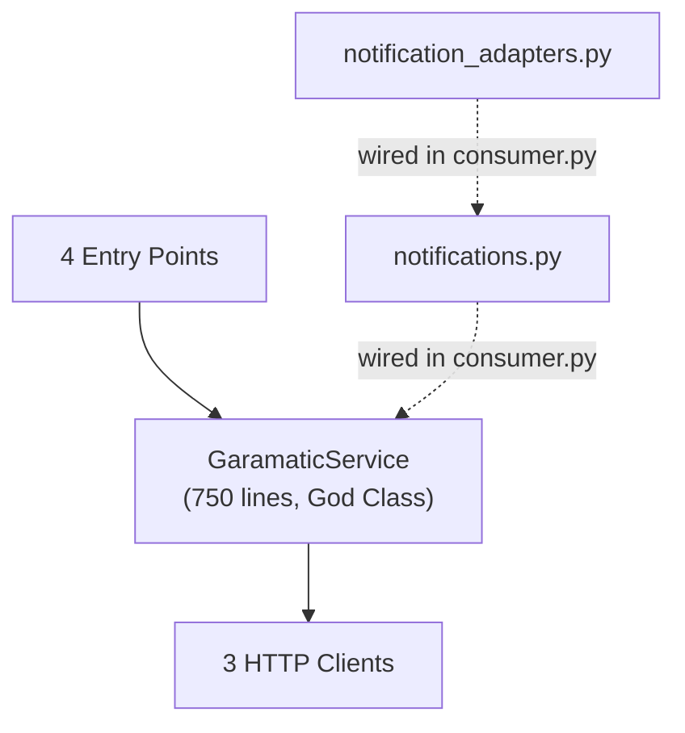

# Garamatic Agentic Service — Code Review

## Overview

The **agentic-service** is a Python-based AI integration layer for the Garamatic platform. It exposes domain operations (tickets, invoices, emails) through four entry points: an MCP server (for AI agents), a REST API, a RabbitMQ event consumer, and a LangGraph AI agent.

| Metric | Value |
|--------|-------|
| Source files | 15 modules (~3,500 lines) |
| Test files | 10 files (~2,200 lines, 205 tests) |
| Dependencies | 16 runtime, 6 dev |
| Entry points | 4 (`garamatic-mcp`, `garamatic-api`, `garamatic-consumer`, `garamatic-agent`) |

---

## Architecture Assessment

### Strengths

- **Hexagonal architecture** ([ports.py](src/agentic_service/ports.py)): Clean port/adapter separation using Python `Protocol` classes. Service layer depends on abstractions, not HTTP clients.
- **Resilience patterns** ([clients.py](src/agentic_service/clients.py)): Retry with exponential backoff (`tenacity`) and circuit breakers (`pybreaker`). Production-grade.
- **Structured logging**: Consistent `structlog` usage across all modules.
- **Multi-surface exposure**: Same domain logic accessible via MCP, REST, events, and AI agent — good DRY approach.
- **Dependency injection**: Service layer receives ports via constructor, enabling clean testing.
- **Idempotency**: `idempotency.py` provides deterministic keys for invoices and emails; `consumer.py` has `IdempotencyStore` for deduplication.
- **HTML escaping**: `notifications.py` templates use `html.escape()` on all interpolated variables.

### Concerns

> [!NOTE]
> `notifications.py` and `notification_adapters.py` are wired into the event consumer. `service.py` still uses inline `send_email` for direct API calls, which is intentional (API wants immediate feedback, consumer wants async notification).

---

## Critical Findings

### 🔴 C1: No Authentication on Any Entry Point

| Surface | Auth | Risk |
|---------|------|------|
| REST API ([api.py](src/agentic_service/api.py)) | ⚠️ Optional | `API_KEY` env var enables auth; empty by default allows all requests |
| MCP Server ([server.py](src/agentic_service/server.py)) | ❌ None | Open relay risk if exposed beyond stdio |
| RabbitMQ Consumer | ⚠️ Default `guest:guest` | Docker-compose uses `rabbitmq` network; credentials should be overridden in production |

The API creates invoices and sends emails. Without `API_KEY` set, this is exploitable.

**Status**: Partially fixed — `API_KEY` is now in `docker-compose.yml` with a placeholder. Still requires operator action.

### 🔴 C2: Non-Atomic Multi-Step Operations

[service.py](src/agentic_service/service.py) `resolve_ticket` resolves a ticket then queues an invoice via RabbitMQ. If MQ fails after the ticket is resolved, the system is in an inconsistent state with no rollback.

**Status**: Known limitation. Requires outbox pattern or compensating transaction. Documented in code.

---

## Major Findings

### 🟠 M1: God Class — `GaramaticService` (~750 lines)

[service.py](src/agentic_service/service.py) handles tickets, invoices, emails, and customer context in one class. Violates SRP.

**Status**: Architectural refactor out of QA scope.

### 🟠 M2: `pybreaker` Is Not Async-Aware

[clients.py](src/agentic_service/clients.py) uses `pybreaker.CircuitBreaker` as a decorator on async methods.

**Status**: Verified safe — modern `pybreaker` auto-detects coroutines via `asyncio.iscoroutinefunction()`. The decorator order is correct (breaker outer, retry inner).

### 🟠 M3: Each Entry Point Creates Isolated Instances

Every entry point creates its own `GaramaticService` + client instances. Circuit breaker state is not shared across processes.

**Status**: By design — each entry point is a separate process. `api.py` reuses its service via `app.state.service`.

### 🟠 M4: Agent Has Configurable Values

[agent.py](src/agentic_service/agent.py):
- ✅ Model: reads from `config.llm_model` or `config.openai_model`
- ✅ Approval threshold: injected dynamically via `_build_system_prompt()`
- ✅ SQLite path: reads from `AGENT_DB_PATH` env var
- ⚠️ `call_model()` is sync — LangGraph node design; uses `model.invoke()` internally

---

## Minor Findings

| ID | File | Finding | Status |
|----|------|---------|--------|
| m1 | [service.py](src/agentic_service/service.py) | Magic strings for statuses (`"open"`, `"resolved"`, `"paid"`) — should be enums | Open |
| m2 | [clients.py](src/agentic_service/clients.py) | Hardcoded 30s timeout — should come from config | Open |
| m3 | [config.py](src/agentic_service/config.py) | `@cache` on `get_settings()` makes test overrides painful | Open |
| m4 | [api.py](src/agentic_service/api.py) | No pagination on `GET /tickets` | Open |
| m5 | [consumer.py](src/agentic_service/consumer.py) | Hardcoded queue name `"agentic_consumer"` | Open |
| m6 | [notifications.py](src/agentic_service/notifications.py) | Templates are hardcoded in English with no i18n support | Open |
| m7 | [service.py](src/agentic_service/service.py) | `health_check()` calls `list_tickets(limit=1)` + `list_customer_invoices("test@example.com")` — creates noise in upstream logs | Open |
| m8 | [clients.py](src/agentic_service/clients.py) | Circuit breaker instances are module-level singletons — shared across all client instances | By design |
| m9 | [service.py](src/agentic_service/service.py) | `send_email` error path exposes raw exception in user-facing message | Partially fixed — logs are redacted, error message still exposes exception string |
| m10 | [api.py](src/agentic_service/api.py) | PII (customer emails) logged in structured logs | **Fixed** — `_redact_email()` helper masks emails in `service.py` logs |

---

## Fixed Since Original Review

| ID | Original Finding | Fix |
|----|-----------------|-----|
| C2 | HTML injection in notification templates | `html.escape()` used on all template variables |
| C4 | No idempotency in event consumer | `IdempotencyStore` added with `is_processed`/`mark_processed` |
| C5 | Routing key mismatch | Consumer strips `event.` prefix before calling `composer.notify()` |
| C6 | Path traversal in `tenant_context.py` | File removed from codebase |
| C7 | Agent tools registered as sync | `coroutine=` parameter used in `StructuredTool.from_function()` |
| M6 | Retry/breaker decorator order | Already correct — breaker outer, retry inner |
| M7 | EventView alias precedence | Already correct — custom overrides defaults |
| M8 | `_map_client_error()` raises inside | Intentional — passthrough for `CircuitBreakerError` and `ApprovalRequiredError` |
| M9 | `create_facade_service()` private access | Function doesn't exist in codebase |
| m10 | `.db` files not in `.gitignore` | `*.db` added to `.gitignore` |
| m11 | Deprecated `version: '3.8'` | Removed from `docker-compose.yml` |
| m12 | `uv.lock` gitignored | False — `uv.lock` is tracked in git |
| m13 | MCP resources create temporary services | False — resources use `_lifespan_service` global |
| m14 | `datetime.now()` uses local time | Already uses `datetime.now(UTC)` everywhere |
| m15 | `create_service()` is dead code | False — actively used by all entry points |
| m21 | Blocking `input()` in async loop | Fixed — uses `asyncio.to_thread()` |
| m22 | Consumer double-close risk | Fixed — `close()` only closes if `owns_service=True` |
| m23-24 | `tenant_context.py` issues | File doesn't exist |
| m27 | Invoice returns 200 with `not_found` | False — returns 404 via `HTTPException` |

---

## Test Coverage Assessment

### What's Tested

| Module | Test File | Tests | Quality |
|--------|-----------|-------|---------|
| [service.py](src/agentic_service/service.py) | [test_service.py](tests/test_service.py) | 25 | ⭐⭐⭐⭐⭐ Hexagonal testing with fake ports |
| [api.py](src/agentic_service/api.py) | [test_api.py](tests/test_api.py) | 15 | ⭐⭐⭐⭐ Good endpoint + error coverage |
| [clients.py](src/agentic_service/clients.py) | [test_clients.py](tests/test_clients.py) | 15 | ⭐⭐⭐ Missing retry/timeout/malformed response tests |
| [server.py](src/agentic_service/server.py) | [test_mcp_tools.py](tests/test_mcp_tools.py) | 14 | ⭐⭐⭐⭐ All tools covered |
| [notifications.py](src/agentic_service/notifications.py) | [test_notification_composer.py](tests/test_notification_composer.py) | 22 | ⭐⭐⭐⭐⭐ Best file — boundary tests with in-memory adapters |
| [agent.py](src/agentic_service/agent.py) | [test_agent.py](tests/test_agent.py) | 17 | ⭐⭐⭐⭐ Agent initialization, tools, conversation flow |
| [consumer.py](src/agentic_service/consumer.py) | [test_consumer.py](tests/test_consumer.py) | 10 | ⭐⭐⭐⭐ Event handling, retry, DLQ, shutdown |
| E2E | [tests/e2e/](tests/e2e/) | 77 | ⭐⭐⭐⭐⭐ Full workflows through API and MCP |

**Total: 205 tests across ~2,200 lines of test code**

### What's NOT Tested

| Module | Lines | Risk |
|--------|-------|------|
| [notification_adapters.py](src/agentic_service/notification_adapters.py) | 174 | 🟡 Production adapters (production code is thin, fakes are well-tested) |
| [llm_adapter.py](src/agentic_service/llm_adapter.py) | 80 | 🟡 LLM provider factory — requires actual API keys to test |

---

## Infrastructure Review

### Dockerfile

- ⚠️ Non-root user — **known gap**: container currently runs as root (no `USER` instruction in Dockerfile); add a non-root user for production hardening
- ✅ Uses `uv` via official `COPY --from=ghcr.io/astral-sh/uv:latest`
- ✅ Multi-stage not needed for a small Python service
- ✅ `uv.lock` is tracked in git for reproducible builds
- ✅ Health check via `HEALTHCHECK` in docker-compose

### docker-compose.yml

- ✅ `version:` key removed
- ✅ `API_KEY` placeholder added
- ⚠️ `AGENT_DB_PATH` set to `/app/data/approvals.db` (tmpfs, resets on restart; add a persistent volume for production)
- ✅ `healthcheck` block added
- ⚠️ Default `guest:guest` RabbitMQ credentials — should be overridden in production

---

## Build / Environment

- ✅ Tests collect and run: `pytest` passes 205 tests
- ✅ Package is installed via `uv sync` / `pip install -e "."`
- ✅ `PYTHONPATH` configured via `pyproject.toml` `packages = ["src/agentic_service"]`

---

## Prioritized Recommendations

### 🔴 Immediate (Security & Correctness)

1. **Set `API_KEY` in production** — empty value disables all auth
2. **Set `CORS_ORIGINS` explicitly** — `"*"` allows any origin
3. **Override RabbitMQ credentials** — `guest:guest` is insecure for production

### 🟠 Short-Term (Architecture & Bugs)

4. **Split `GaramaticService`** into `TicketService`, `InvoiceService`, `EmailService`, `CustomerContextService`
5. **Add outbox pattern** for atomic `resolve_ticket + invoice` operations
6. **Make client timeout configurable** — currently hardcoded 30s
7. **Add `TicketStatus` / `InvoiceStatus` enums** — replace magic strings
8. **Add health check endpoint to consumer** — separate from API server

### 🟡 Medium-Term (Reliability & Operability)

9. **Add pagination** to `GET /tickets`
10. **Add i18n support** to notification templates
11. **Mask remaining PII** — review all `logger.*` calls for email/phone leakage
12. **Add consumer metrics** — messages processed, retries, DLQ rate
13. **Add agent metrics** — tool calls, latency, errors

---

## What's Done Well

- **Hexagonal architecture** is genuinely well-executed — ports/adapters separation is clean
- **Resilience patterns** (retries, circuit breakers) are production-minded
- **Structured logging** is consistent and useful
- **Test quality** is high — proper mocking, error case coverage, E2E workflows
- **README** is thorough and well-structured
- **The `agentos.md` RFC** shows good forward-thinking about infrastructure evolution
