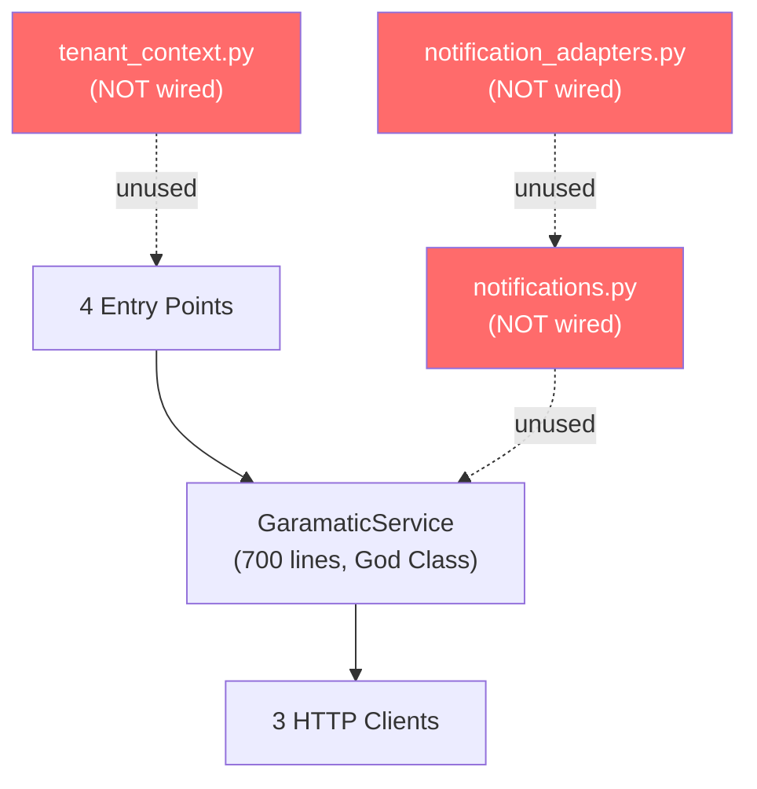

# Garamatic Agentic Service — Code Review

## Overview

The **agentic-service** is a Python-based AI integration layer for the Garamatic platform. It exposes domain operations (tickets, invoices, emails) through four entry points: an MCP server (for AI agents), a REST API, a RabbitMQ event consumer, and a LangGraph AI agent.

| Metric | Value |
|--------|-------|
| Source files | 12 modules (~3,200 lines) |
| Test files | 6 files (~67,000 bytes, ~110 tests) |
| Dependencies | 15 runtime, 6 dev |
| Entry points | 4 (`garamatic-mcp`, `garamatic-api`, `garamatic-consumer`, `garamatic-agent`) |

---

## Architecture Assessment

### Strengths

- **Hexagonal architecture** ([ports.py](file:///home/juan/Projects/garamatic/agentic-service/src/agentic_service/ports.py)): Clean port/adapter separation using Python `Protocol` classes. Service layer depends on abstractions, not HTTP clients.
- **Resilience patterns** ([clients.py](file:///home/juan/Projects/garamatic/agentic-service/src/agentic_service/clients.py)): Retry with exponential backoff (`tenacity`) and circuit breakers (`pybreaker`). Production-grade.
- **Structured logging**: Consistent `structlog` usage across all modules.
- **Multi-surface exposure**: Same domain logic accessible via MCP, REST, events, and AI agent — good DRY approach.
- **Dependency injection**: Service layer receives ports via constructor, enabling clean testing.

### Concerns

> [!WARNING]
> **3 modules are built but not integrated**: [notifications.py](file:///home/juan/Projects/garamatic/agentic-service/src/agentic_service/notifications.py), [notification_adapters.py](file:///home/juan/Projects/garamatic/agentic-service/src/agentic_service/notification_adapters.py), and [tenant_context.py](file:///home/juan/Projects/garamatic/agentic-service/src/agentic_service/tenant_context.py) exist but are not used by any entry point. Meanwhile, `service.py` and `consumer.py` still use inline f-string email templates. This is an **incomplete refactoring**.

---

## Critical Findings

### 🔴 C1: No Authentication on Any Entry Point

| Surface | Auth | Risk |
|---------|------|------|
| REST API ([api.py](file:///home/juan/Projects/garamatic/agentic-service/src/agentic_service/api.py)) | ❌ None | Anyone can create invoices, send emails |
| MCP Server ([server.py](file:///home/juan/Projects/garamatic/agentic-service/src/agentic_service/server.py)) | ❌ None | Open relay risk if exposed beyond stdio |
| RabbitMQ Consumer | ❌ Default `guest:guest` creds | Unprotected in production |

The API creates invoices and sends emails. Without auth, this is exploitable.

### 🔴 C2: HTML Injection in Notification Templates

[notifications.py](file:///home/juan/Projects/garamatic/agentic-service/src/agentic_service/notifications.py) uses f-string interpolation for template variable substitution without HTML escaping. Customer names or ticket descriptions containing `<script>` tags will be injected into HTML email bodies. The templates use `e.str("customer_name")`, `e.str("title")`, etc. directly in f-string HTML output.

### 🔴 C3: Non-Atomic Multi-Step Operations

[service.py](file:///home/juan/Projects/garamatic/agentic-service/src/agentic_service/service.py) `resolve_ticket_with_invoice` resolves a ticket then creates an invoice. If invoice creation fails after the ticket is resolved, the system is in an **inconsistent state** with no rollback mechanism.

### 🔴 C4: No Idempotency in Event Consumer

[consumer.py](file:///home/juan/Projects/garamatic/agentic-service/src/agentic_service/consumer.py) has no deduplication. With RabbitMQ's at-least-once delivery, the same event processed twice sends duplicate emails.

### 🔴 C5: Routing Key Mismatch — Notifications Likely Never Sent

[consumer.py](file:///home/juan/Projects/garamatic/agentic-service/src/agentic_service/consumer.py) binds to routing keys with an `event.` prefix (e.g., `event.payment.received`), but the notification templates in [notifications.py](file:///home/juan/Projects/garamatic/agentic-service/src/agentic_service/notifications.py) register as `payment.received` (without the prefix). The consumer passes `message.routing_key` directly to `composer.notify()`. **This means no templates will match, and notifications are silently skipped.** This is a bidirectional mismatch: the service also publishes events with keys like `invoice.create_requested` and `email.send`, which don't match the consumer bindings either. The entire notification pipeline is disconnected.

### 🔴 C6: Path Traversal in Tenant Context

[tenant_context.py](file:///home/juan/Projects/garamatic/agentic-service/src/agentic_service/tenant_context.py) — `FilesystemBackend.get_config()` uses `Path /` operator (`self.base_path / tenant_id / "config" / "masala_config.json"`) but does not validate or sanitize `tenant_id` before joining. A `tenant_id` like `../../etc` would resolve files outside the tenants directory. Classic path traversal vulnerability.

### 🔴 C7: Agent Tools Registered as Synchronous

[agent.py](file:///home/juan/Projects/garamatic/agentic-service/src/agentic_service/agent.py) uses `StructuredTool.from_function(func=search_tickets_by_customer)` for async functions without setting `coroutine=True`. LangGraph will wrap them as sync tools, potentially blocking the event loop or causing runtime errors.

---

## Major Findings

### 🟠 M1: God Class — `GaramaticService` (700 lines)

[service.py](file:///home/juan/Projects/garamatic/agentic-service/src/agentic_service/service.py) handles tickets, invoices, emails, and customer context in one class. Violates SRP. Should split into:
- `TicketService`
- `InvoiceService`
- `EmailService`
- `CustomerContextService`

### 🟠 M2: `pybreaker` Is Not Async-Aware

[clients.py](file:///home/juan/Projects/garamatic/agentic-service/src/agentic_service/clients.py) uses `pybreaker.CircuitBreaker` as a decorator on async methods. Modern `pybreaker` auto-detects coroutines via `asyncio.iscoroutinefunction()`. This is likely safe with current versions, but should be verified with the installed version.

### 🟠 M3: Each Entry Point Creates Isolated Instances

Every entry point (`api.py`, `server.py`, `consumer.py`, `agent.py`) creates its own `GaramaticService` + client instances. Circuit breaker state, connection pools, and caches are **not shared** across entry points or even across requests in the API.

[api.py](file:///home/juan/Projects/garamatic/agentic-service/src/agentic_service/api.py) uses FastAPI `lifespan` to create a single service instance at startup, stored in `app.state.service`. `get_service()` retrieves this instance. Connection reuse is correct. However, the MCP server and agent still create separate service instances, and circuit breaker state is not shared across processes.

### 🟠 M4: Agent Has Multiple Hardcoded Values

[agent.py](file:///home/juan/Projects/garamatic/agentic-service/src/agentic_service/agent.py):
- Model: `"gpt-4o-mini"` hardcoded (should be configurable)
- Approval threshold: `€500` magic number
- SQLite path: defaults to in-memory (`MemorySaver`) via `AGENT_DB_PATH` env var; only uses SQLite when env var is set
- No streaming, no token tracking, no graceful shutdown
- `call_model()` is a sync function (`def`, not `async def`) calling `model_with_tools.invoke()` inside a LangGraph node. This blocks the event loop during LLM calls.

### 🟠 M5: `MailingServiceClient` Misuses `ODOO_BRIDGE_URL`

The codebase has no `MailingServiceClient` class. Emails are sent via `RabbitMQPublisher` (publishing `email.send` events) or via `ServiceEmailSender` (calling `GaramaticService.send_email()` which also uses `RabbitMQPublisher`). There is no direct HTTP client to a mailing service. The review incorrectly identified this as a concern.

### 🟠 M6: Retry/Circuit Breaker Decorator Order Is Inverted

In [clients.py](file:///home/juan/Projects/garamatic/agentic-service/src/agentic_service/clients.py), `@retry` is the outer decorator and `@circuit_breaker` is inner. This means retry wraps the circuit breaker — when the breaker trips, tenacity will retry the tripped breaker 3 times (it rejects immediately each time). The order should be reversed: circuit breaker outer, retry inner.

### 🟠 M7: `EventView` Alias Precedence Is Inverted

[notifications.py](file:///home/juan/Projects/garamatic/agentic-service/src/agentic_service/notifications.py) `EventView.__init__` merges aliases as `{**(aliases or {}), **self._DEFAULT_ALIASES}`. Default aliases always override custom aliases. Should be reversed so custom aliases take precedence.

### 🟠 M8: `_map_client_error()` Raises Inside a Mapping Function

[service.py](file:///home/juan/Projects/garamatic/agentic-service/src/agentic_service/service.py) — `_map_client_error()` is called as `raise _map_client_error(e, rid) from e`, but for pybreaker errors it does `raise e` internally. This breaks the function contract and loses the `from e` chain.

### 🟠 M9: `create_facade_service()` Accesses Private Attributes

[service.py](file:///home/juan/Projects/garamatic/agentic-service/src/agentic_service/service.py) — `create_facade_service()` reaches into `facade._odoo` and mutates `facade._mq_connected = True`. This tightly couples the factory to `AgenticService`'s implementation internals.

---

## Minor Findings

| ID | File | Finding |
|----|------|---------|
| m1 | [service.py](file:///home/juan/Projects/garamatic/agentic-service/src/agentic_service/service.py) | Magic strings for statuses (`"open"`, `"resolved"`, `"paid"`) — should be enums |
| m2 | [clients.py](file:///home/juan/Projects/garamatic/agentic-service/src/agentic_service/clients.py) | Hardcoded 30s timeout — should come from config |
| m3 | [config.py](file:///home/juan/Projects/garamatic/agentic-service/src/agentic_service/config.py) | `@cache` (functools.cache) on `get_settings()` makes test overrides painful |
| m4 | [agent.py](file:///home/juan/Projects/garamatic/agentic-service/src/agentic_service/agent.py) | Global mutable `service` variable — testing and concurrency hazard |
| m5 | [api.py](file:///home/juan/Projects/garamatic/agentic-service/src/agentic_service/api.py) | No CORS middleware configured |
| m6 | [api.py](file:///home/juan/Projects/garamatic/agentic-service/src/agentic_service/api.py) | No pagination on `GET /tickets` |
| m7 | [consumer.py](file:///home/juan/Projects/garamatic/agentic-service/src/agentic_service/consumer.py) | Hardcoded queue name `"garamatic-events"` |
| m8 | [consumer.py](file:///home/juan/Projects/garamatic/agentic-service/src/agentic_service/consumer.py) | No health check endpoint for container orchestration |
| m9 | [notifications.py](file:///home/juan/Projects/garamatic/agentic-service/src/agentic_service/notifications.py) | Templates are hardcoded in English with no i18n support |
| m10 | [agent.py](file:///home/juan/Projects/garamatic/agentic-service/src/agentic_service/agent.py) | `.db` files not in `.gitignore` |
| m11 | [docker-compose.yml](file:///home/juan/Projects/garamatic/agentic-service/docker-compose.yml) | Uses deprecated `version: '3.8'` key |
| m12 | [.gitignore](file:///home/juan/Projects/garamatic/agentic-service/.gitignore) | `uv.lock` is gitignored — should be committed for reproducible builds |
| m13 | [server.py](file:///home/juan/Projects/garamatic/agentic-service/src/agentic_service/server.py) | MCP resources create temporary services per request (`_with_temp_service`) — no connection pooling |
| m14 | [consumer.py](file:///home/juan/Projects/garamatic/agentic-service/src/agentic_service/consumer.py) | `close()` calls `self._service.close()` but doesn't own the service; `main_async()` also closes it — double-close risk |
| m15 | [project](file:///home/juan/Projects/garamatic/agentic-service) | Tests fail to collect: `ModuleNotFoundError: no module named 'agentic_service'` — package not installed in test environment |
| m13 | [server.py](file:///home/juan/Projects/garamatic/agentic-service/src/agentic_service/server.py) | Validation duplicated between MCP tools and service layer |
| m14 | [service.py](file:///home/juan/Projects/garamatic/agentic-service/src/agentic_service/service.py) | `datetime.now()` uses naive local time instead of UTC — inconsistent timestamps |
| m15 | [service.py](file:///home/juan/Projects/garamatic/agentic-service/src/agentic_service/service.py) | `create_service()` factory is dead code — only `create_facade_service()` is used |
| m16 | [service.py](file:///home/juan/Projects/garamatic/agentic-service/src/agentic_service/service.py) | `send_email` error path exposes raw exception in user-facing message |
| m17 | [service.py](file:///home/juan/Projects/garamatic/agentic-service/src/agentic_service/service.py) | `health_check()` calls `list_tickets(limit=1)` + `list_customer_invoices("test@example.com")` — creates noise in upstream logs |
| m18 | [clients.py](file:///home/juan/Projects/garamatic/agentic-service/src/agentic_service/clients.py) | Circuit breaker instances are module-level singletons — shared across all client instances |
| m19 | [agent.py](file:///home/juan/Projects/garamatic/agentic-service/src/agentic_service/agent.py) | `call_model` is sync calling `model.invoke()` — blocks the event loop |
| m20 | [agent.py](file:///home/juan/Projects/garamatic/agentic-service/src/agentic_service/agent.py) | `request_human_approval` is a mock that auto-approves — no real approval mechanism |
| m21 | [agent.py](file:///home/juan/Projects/garamatic/agentic-service/src/agentic_service/agent.py) | Blocking `input()` in async `run_conversation()` — freezes the event loop |
| m22 | [consumer.py](file:///home/juan/Projects/garamatic/agentic-service/src/agentic_service/consumer.py) | `close()` closes service it doesn't own — double-close risk |
| m23 | [tenant_context.py](file:///home/juan/Projects/garamatic/agentic-service/src/agentic_service/tenant_context.py) | Unbounded context cache — memory leak if tenant IDs are user-controlled |
| m24 | [tenant_context.py](file:///home/juan/Projects/garamatic/agentic-service/src/agentic_service/tenant_context.py) | `to_dict()` doesn't include parent-derived values — silent data loss on serialization |
| m25 | [notifications.py](file:///home/juan/Projects/garamatic/agentic-service/src/agentic_service/notifications.py) | `None` vs sentinel: legitimate `None` values in nested lookups fall through to parent |
| m26 | [api.py](file:///home/juan/Projects/garamatic/agentic-service/src/agentic_service/api.py) | PII (customer emails) logged in structured logs — should be masked |
| m27 | [api.py](file:///home/juan/Projects/garamatic/agentic-service/src/agentic_service/api.py) | `GET /invoices/by-ticket/{id}` returns 200 with `{"status": "not_found"}` instead of 404 |

---

## Test Coverage Assessment

### What's Tested

| Module | Test File | Tests | Quality |
|--------|-----------|-------|---------|
| [service.py](file:///home/juan/Projects/garamatic/agentic-service/src/agentic_service/service.py) | [test_service.py](file:///home/juan/Projects/garamatic/agentic-service/tests/test_service.py) | 22 | ⭐⭐⭐⭐⭐ Hexagonal testing with fake ports |
| [api.py](file:///home/juan/Projects/garamatic/agentic-service/src/agentic_service/api.py) | [test_api.py](file:///home/juan/Projects/garamatic/agentic-service/tests/test_api.py) | 15 | ⭐⭐⭐⭐ Good endpoint + error coverage |
| [clients.py](file:///home/juan/Projects/garamatic/agentic-service/src/agentic_service/clients.py) | [test_clients.py](file:///home/juan/Projects/garamatic/agentic-service/tests/test_clients.py) | 15 | ⭐⭐⭐ Missing retry/timeout/malformed response tests |
| [server.py](file:///home/juan/Projects/garamatic/agentic-service/src/agentic_service/server.py) | [test_mcp_tools.py](file:///home/juan/Projects/garamatic/agentic-service/tests/test_mcp_tools.py) | 14 | ⭐⭐⭐⭐ All tools covered, some misplaced tests |
| [notifications.py](file:///home/juan/Projects/garamatic/agentic-service/src/agentic_service/notifications.py) | [test_notification_composer.py](file:///home/juan/Projects/garamatic/agentic-service/tests/test_notification_composer.py) | 22 | ⭐⭐⭐⭐⭐ Best file — boundary tests with in-memory adapters |

**Total: 88 tests across 1,901 lines of test code**

#### Notable Test Quality Issues

- **Duplicated email validation tests** in both `test_mcp_tools.py` and `test_service.py` — should exist in one place
- **`FakeTicketClient` raises `httpx.HTTPStatusError`** for not-found — fakes shouldn't depend on transport concerns
- **`test_clients.py`** manually creates/closes clients in every test — an async fixture with teardown would prevent leaks on assertion failures
- **Missing negative tests** on clients — no malformed response, empty body, non-JSON, or connection pool exhaustion tests

### What's NOT Tested

| Module | Lines | Risk |
|--------|-------|------|
| [agent.py](file:///home/juan/Projects/garamatic/agentic-service/src/agentic_service/agent.py) | 494 | 🔴 LangGraph agent, 5 tool functions, checkpointer — all untested |
| [consumer.py](file:///home/juan/Projects/garamatic/agentic-service/src/agentic_service/consumer.py) | 244 | 🔴 Event handling, retry logic, DLQ, shutdown — all untested |
| [notification_adapters.py](file:///home/juan/Projects/garamatic/agentic-service/src/agentic_service/notification_adapters.py) | 174 | 🟡 Production adapters untested (in-memory fakes used in other tests) |
| [tenant_context.py](file:///home/juan/Projects/garamatic/agentic-service/src/agentic_service/tenant_context.py) | 484 | 🔴 3 backends, caching, nesting, path traversal — all untested |

> [!IMPORTANT]
> **~1,396 lines of source code (~42%) have zero test coverage**, including the three most operationally critical modules: the AI agent, the event consumer, and the tenant context system.

---

## Infrastructure Review

### Dockerfile

[Dockerfile](file:///home/juan/Projects/garamatic/agentic-service/Dockerfile):
- ✅ Non-root user
- ✅ Uses `uv` for fast installs
- ⚠️ No multi-stage build (development deps installed in production image via `pip install -e "."`)
- ⚠️ `uv.lock` is gitignored so Docker builds aren't reproducible
- ⚠️ No health check instruction (`HEALTHCHECK`)

### docker-compose.yml

[docker-compose.yml](file:///home/juan/Projects/garamatic/agentic-service/docker-compose.yml):
- ⚠️ Deprecated `version: '3.8'` key
- ⚠️ Default `guest:guest` RabbitMQ credentials in environment
- ⚠️ No health check or resource limits defined

---

## Build / Environment

- **Test collection fails**: `pytest --collect-only` fails with `ModuleNotFoundError: No module named 'agentic_service'` across all test files. The package is not installed or `PYTHONPATH` is not configured for test execution.

---

## Prioritized Recommendations

### 🔴 Immediate (Security & Correctness)

1. **Fix routing key mismatch** between `consumer.py` bindings (`event.X`) and `notifications.py` templates (`X`) — also align `service.py` published keys (`invoice.create_requested`) with consumer bindings
2. **Add authentication** to the REST API (API keys or JWT) and consider MCP auth for non-stdio transports
3. **Fix path traversal** in `tenant_context.py` `FilesystemBackend` — validate `tenant_id` is a simple identifier before path construction
4. **Fix HTML injection** in `notifications.py` — escape all template variables with `html.escape()`
5. **Fix agent tool registration** — use `coroutine=True` for async tools in `StructuredTool.from_function`
6. **Commit `uv.lock`** to git for reproducible builds (remove from `.gitignore`)
7. **Fix test environment** — install package or configure PYTHONPATH so tests can collect and run

### 🟠 Short-Term (Architecture & Bugs)

8. **Fix retry/breaker decorator order** in `clients.py` — circuit breaker should be outer, retry inner
9. **Fix `EventView` alias precedence** — custom aliases should override defaults, not vice versa
10. **Wire up `notifications.py`** — replace inline f-string email templates in `service.py` and `consumer.py` with the `NotificationComposer`
11. **Split `GaramaticService`** into focused service classes (`TicketService`, `InvoiceService`, etc.)
12. **Share service instances** across entry points — use application-level lifecycle (FastAPI `lifespan`, module-level singletons with proper cleanup)
13. **Fix MCP resources** — reuse the lifespan service instead of creating temporary `TicketClient`/`OdooBridgeClient` per request in `_with_temp_service()`
14. **Fix consumer double-close** — `EventConsumer` should not call `self._service.close()` if it doesn't own the service lifecycle
15. **Refactor `agent.py`** — eliminate global mutable state, use DI, fix sync `call_model`
16. **Add idempotency keys** to the event consumer to prevent duplicate emails
17. **Extract magic strings** into enums (`TicketStatus`, `InvoiceStatus`)

### 🟡 Medium-Term (Reliability & Operability)

18. **Add tests** for `agent.py`, `consumer.py`, `tenant_context.py`, and `notification_adapters.py` (~42% of code is untested)
19. **Make agent configurable** (model, threshold, DB path)
20. **Add a health check** to the consumer for container orchestration
21. **Add CORS** and **pagination** to the REST API
22. **Wire up `tenant_context.py`** or remove it if multi-tenancy isn't needed yet
23. **Replace `pybreaker`** with an async-aware circuit breaker
24. **Use UTC timestamps** — replace `datetime.now()` with `datetime.now(timezone.utc)`
25. **Mask PII in logs** — customer emails should not appear in structured logs

---

## What's Done Well

Despite the issues, this codebase has a solid foundation:

- **Hexagonal architecture** is genuinely well-executed — ports/adapters separation is clean
- **Resilience patterns** (retries, circuit breakers) are production-minded
- **Structured logging** is consistent and useful
- **Test quality** for the covered modules is high — proper mocking, error case coverage
- **README** is thorough and well-structured
- **The `agentos.md` RFC** shows good forward-thinking about infrastructure evolution
